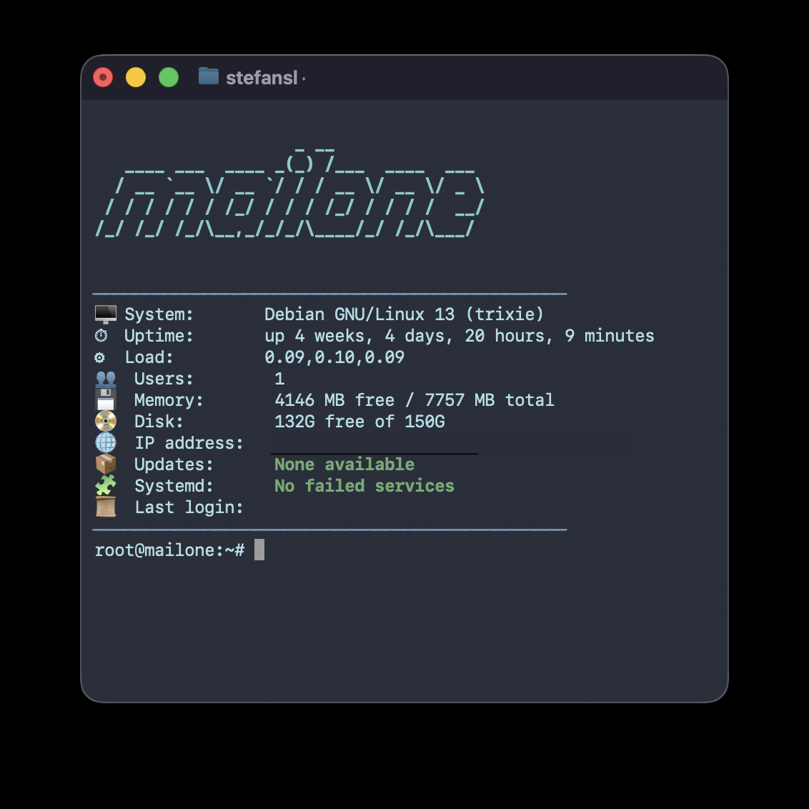

# Linux Welcome Screen

A lightweight, cross-distro **dynamic login dashboard** for Linux.  
Now with multi-shell support — works with **Bash, Zsh, Fish, Ksh, Dash** and more!


---

## Features

- 🖥 Shows hostname, OS, uptime, load, memory, disk, and IP
- 📦 Counts available updates for your distro’s package manager
- 🧩 Detects failed systemd/SysV services
- 🔄 Warns when a reboot is required (Debian/Ubuntu, Fedora/RHEL, openSUSE, kernel updates on Arch/Alpine & others)
- 📜 Shows your previous login (via `last`, or `wtmpdb` on Debian 13+)
- 🧱 Fancy ASCII banner via `figlet`
- 🐚 Works in Bash, Zsh, Fish, Dash, Ksh

---

## Universal One-Liner Install

```bash
curl -sL https://raw.githubusercontent.com/stefansl/linux-welcome-screen/main/install.sh | sudo bash
```

The installer:

- installs the dashboard to `/etc/profile.d/welcome.sh` and hooks it into Zsh and Fish if present
- installs `figlet` for the ASCII banner if it is missing
- on apt-based systems without `last` (e.g. Debian 13 Trixie), installs `wtmpdb` and `libpam-wtmpdb` so the last login can be shown

---

## Updating

Run the installer again — it is safe to re-run and only overwrites the dashboard script:

```bash
curl -sL https://raw.githubusercontent.com/stefansl/linux-welcome-screen/main/install.sh | sudo bash
```

> **Note:** `raw.githubusercontent.com` caches files, so a server may still get the old version for a while after a new release.
> To bypass the cache, use a commit hash instead of `main`:
>
> ```bash
> curl -sL https://raw.githubusercontent.com/stefansl/linux-welcome-screen/<commit-hash>/install.sh | sudo bash
> ```

---

## Troubleshooting

**“Last login” shows `n/a`**

- Debian 13 and newer distributions no longer ship `last`. Install the replacement (the installer does this automatically on apt-based systems):
  ```bash
  sudo apt install wtmpdb libpam-wtmpdb
  ```
  Logins are recorded from then on, so the previous login appears from the second login after installation.
- Right after log rotation of `/var/log/wtmp`, there may be no previous login on record yet.

**“Reboot” never warns on Fedora/RHEL**

- The check uses `needs-restarting -r` from `dnf-utils` / `yum-utils` (or the `dnf needs-restarting` plugin). Install it if it is missing.
